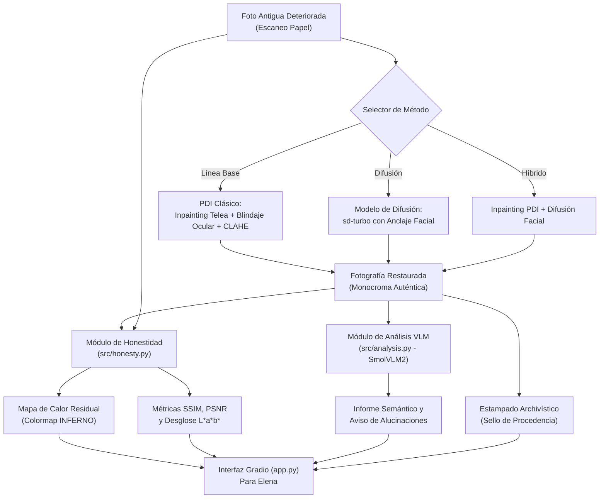

# 🏛️ Restaurador y Analizador de Fotografías Históricas

[](https://www.python.org/downloads/release/python-3120/)
[](https://gradio.app)
[](https://huggingface.co/)
[](https://colab.research.google.com/)

**Trabajo Integrador N°2: Restauración y Mejora de Imágenes con Modelos de Difusión**  
**Materia:** Procesamiento Digital de Imágenes e Introducción a Visión por Computadora  
**Profesor:** Matías Barreto  
**Institución:** IFTS 24 - Tecnicatura Superior en Ciencias de Datos e Inteligencia Artificial (2026)  
**Autor:** Germán Le Piani (`37904207@ifts24.edu.ar`)  
**Repositorio GitHub:** [https://github.com/ger207/Restauracion-de-imagenes-proyecto-final](https://github.com/ger207/Restauracion-de-imagenes-proyecto-final)

---

## 📌 Descripción

Este proyecto es un **Producto Mínimo Viable (MVP)** interactivo diseñado para la restauración, comparación y auditoría ética de fotografías históricas dañadas, rayadas o desvanecidas. 

El sistema combina técnicas clásicas de **Procesamiento Digital de Imágenes (Inpainting morfológico Telea, filtrado bilateral y CLAHE en $L^*a^*b^*$)** con **Modelos Generativos de Difusión** (`stabilityai/sd-turbo`), anclaje anatómico para **Preservación Estricta de Identidad Facial**, y un modelo de **Visión y Lenguaje (VLM: SmolVLM2)** para auditar qué partes de la imagen corresponden a datos reales conservados y cuáles a reconstrucciones generadas por IA.

Para respetar el rigor documental de los archivos históricos, el sistema **preserva de forma estricta el blanco y negro original**, evitando inventar coloraciones sintéticas que puedan desvirtuar la verdad histórica.

---

## 👤 Persona Usuaria (User Persona)

- **Nombre:** Elena (58 años).
- **Rol y Contexto:** Archivista aficionada y voluntaria en la biblioteca popular de su barrio. Digitaliza fotografías donadas por vecinos de las décadas de 1920 a 1970 para exposiciones locales y preservación comunitaria.
- **Problema:** Las fotos en papel fotográfico sufren desvanecimiento de contraste, rayones y grietas físicas severas por doblado del papel. Elena necesita rescatar la nitidez para que los vecinos reconozcan a sus antepasados, pero le preocupa que la IA "invente el pasado" o altere los rostros de las personas.
- **Nivel Técnico:** Medio-bajo. Prefiere interfaces visuales limpias, claras y en español.
- **Valor que aporta este MVP:**
  1. Elimina de forma quirúrgica arrugas y fisuras sin borrar ni alterar los ojos ni las facciones de la persona.
  2. Ofrece anclaje facial anatómico para que la difusión generativa no cambie la identidad del retratado.
  3. Muestra un **mapa de calor residual** de las áreas intervenidas.
  4. Entrega un informe en lenguaje natural sobre qué es dato histórico y qué es reconstrucción estocástica.
  5. Permite exportar la imagen con un sello editorial de catalogación transparente.

---

## 🎥 Demo en Video (5 Minutos)

- **Enlace a la Video-Demo:** `[Video](https://drive.google.com/file/d/1SskzpMi4gFxG1SpCONxkG055IayAFlog/view?usp=drive_link)`.
- **Contenido del Video:**
  1. Presentación de Elena y el dilema del archivo barrial.
  2. Demostración en vivo del flujo completo (carga de foto dañada, remoción de arrugas y realce por difusión).
  3. Demostración de la preservación de identidad facial (sin deformación de rasgos).
  4. Análisis visual del mapa de calor de diferencias y reporte del modelo VLM.

---

## ⚖️ Qué es Real y Qué es Inventado (Reflexión Ética)

> *"Restaurar no es recuperar: la información que se perdió físicamente ya no existe; el modelo la reconstruye de forma verosímil a partir de lo que aprendió de millones de imágenes."*

```
   LA IMAGEN RESTAURADA  =  lo que sobrevivió en el original    (DATO HISTÓRICO)
                         +  lo que el modelo supone verosímil  (RECONSTRUCCIÓN SINTÉTICA)
```

### 1. Cuatro Conceptos Clave:
| Concepto | En este proyecto | Ejemplo en el Archivo Barrial |
|---|---|---|
| **Real** | Píxeles y luminancia ($L^*$) que sobrevivieron al paso del tiempo y al escaneo. | La mirada, la estructura facial y la vestimenta original del retratado. |
| **Ficticio** | Relleno de emulsión faltante y micro-texturas inferidas en zonas de grietas. | La continuidad de la piel sintetizada donde el papel estaba roto. |
| **Creíble** | Apariencia nítida y natural que no genera extrañeza al ojo humano. | La eliminación limpia de fisuras sin dejar borrones ni deformaciones. |
| **Verificable** | Información contrastable mediante documentos independientes o testimonios. | La fisonomía de la persona contrastada con otras fotos del archivo. |

---

## 🚀 Características Principales del MVP

1. **Flujo de Trabajo Limpio y Enfocado:** Carga directa de la fotografía del usuario sin galerías predeterminadas que distraigan.
2. **Remoción Quirúrgica de Arrugas y Grietas (Inpainting Telea):**
   - Detección morfológica multiescala de fracturas de emulsión fotográfica.
   - **Blindaje Ocular:** Detector facial LBP que aísla los ojos para que las pupilas y destellos nunca sean tratados como grietas.
   - Protección perimetral de bordes para evitar sangrado de márgenes de escáner rotos.
3. **Preservación Estricta de Identidad Facial:**
   - Máscara elíptica anatómica con mezcla en espacio $L^*a^*b^*$ que ancla la fisonomía original y previene que los modelos de difusión generen una cara distinta.
4. **Fidelidad Monocromática Documental:**
   - Preservación íntegra de la escala de grises histórica original, evitando inventar coloraciones artificiales.
5. **Auditoría Residual (Mapa de Calor):** Muestra con colormap INFERNO dónde intervino el algoritmo.
6. **Métricas Interpretadas:** Cálculo de SSIM, PSNR y descomposición $L^*a^*b^*$ explicados en lenguaje accesible.
7. **Análisis Semántico con VLM:** Integración con `HuggingFaceTB/SmolVLM2-256M-Instruct` para descripción de época, objetos y advertencias sobre alucinaciones.
8. **Sello Editorial de Procedencia:** Estampado automático para catalogación responsable en bibliotecas.

---

## 🛠️ Stack Tecnológico

| Componente | Herramienta / Modelo | Versión / Licencia |
|---|---|---|
| **Lenguaje** | Python | 3.12 |
| **Gestor de Entorno** | `uv` (Astral) | >= 0.13.6 |
| **Interfaz Web** | Gradio | 6.x (Apache 2.0) |
| **Modelo de Difusión** | `stabilityai/sd-turbo` | Open Rail++ / Inferencia optimizada |
| **Modelo de Análisis VLM** | `HuggingFaceTB/SmolVLM2-256M-Instruct` | Apache 2.0 (Compacto, apto CPU/GPU) |
| **Procesamiento de Imágenes** | OpenCV Headless, Pillow, NumPy | BSD / MIT |
| **Detección Facial LBP** | `scikit-image` | BSD-3-Clause |
| **Métricas Cuantitativas** | `scikit-image` | BSD-3-Clause |
| **Hardware de Prueba Local** | AMD Ryzen 5 3450U, Radeon Graphics integrada, 6 GB RAM | Windows 11 |
| **Hardware Acelerado Recomendado** | NVIDIA Tesla T4 (16 GB VRAM) | Google Colab |

---

## 📐 Arquitectura del Sistema



---

## 💻 Instalación y Ejecución Local

```bash
# 1. Clonar el repositorio
git clone https://github.com/ger207/Restauracion-de-imagenes-proyecto-final.git
cd Restauracion-de-imagenes-proyecto-final

# 2. Instalar dependencias y ejecutar
uv run app.py
```
Abrí tu navegador en `http://127.0.0.1:7860`.

---

## ☁️ Ejecución en Google Colab con Aceleración GPU (Recomendado)

Para disfrutar de inferencia generativa ultra-rápida con GPU NVIDIA T4:
1. Abrí el notebook [`colab/ejecutar_en_colab.ipynb`](https://github.com/ger207/Restauracion-de-imagenes-proyecto-final/blob/main/colab/ejecutar_en_colab.ipynb) en Google Colab.
2. Seleccioná en el menú: `Entorno de ejecución` -> `Cambiar tipo de entorno de ejecución` -> **GPU T4**.
3. Ejecutá las celdas en orden. El parámetro `--share` generará un enlace público `.gradio.live` para usar la aplicación directamente desde tu navegador.

---

## 🤖 Uso de Agentes de IA (Vibe Engineering)

Siguiendo las directrices de **Simon Willison (2025)** sobre *Agentic Engineering*:

- **Decisiones tomadas por Germán (Estudiante):**
  - Elección de la Sub-tarea C (Fotos Antiguas) por su profundidad ética en archivos históricos.
  - Definición de la Persona Usuaria Elena y su contexto de biblioteca barrial.
  - Pruebas activas con imágenes reales complejas tanto en local como en Google Colab con GPU T4.
  - Decisión de descartar la colorización para evitar invenciones cromáticas y asegurar fidelidad histórica en blanco y negro.
  - Identificación de deformaciones faciales en difusión y exigencia de preservación de identidad anatómica.
  - Simplificación de la interfaz gráfica retirando galerías precargadas para un flujo de trabajo directo.
- **Propuestas y soporte del Agente de IA:**
  - Estructuración modular en `src/` (`baseline.py`, `diffusion.py`, `analysis.py`, `honesty.py`).
  - Implementación del anclaje facial anatómico LBP con mezcla en espacio $L^*a^*b^*$.
  - Suite de pruebas unitarias automatizadas (`tests/test_pipeline.py`).
  - Configuración del entorno reproducible con `uv` y notebook optimizado para Colab.

*(La bitácora detallada de decisiones y reflexiones puede consultarse en [`AGENTS.md`](https://github.com/ger207/Restauracion-de-imagenes-proyecto-final/blob/main/AGENTS.md)).*

---

## 📜 Licencia y Autor

- **Autor:** Germán Le Piani - Tecnicatura Superior en Ciencia de Datos e IA, IFTS 24.
- **Licencia:** Código distribuido bajo Licencia MIT.
