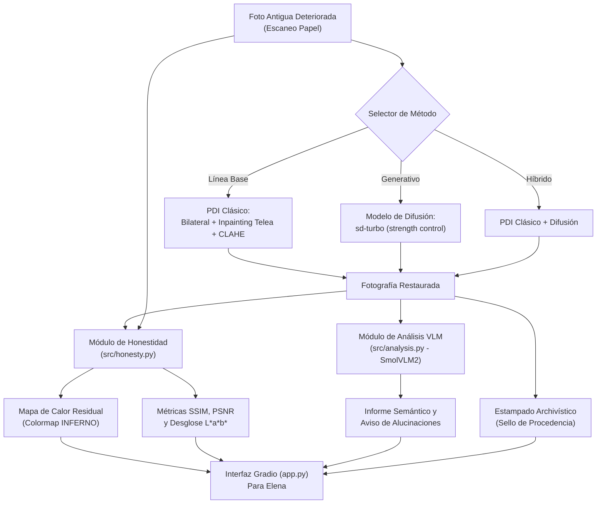

# 🏛️ Restaurador y Analizador de Fotografías Históricas

[](https://www.python.org/downloads/release/python-3120/)
[](https://gradio.app)
[](https://huggingface.co/)
[](https://colab.research.google.com/)

**Trabajo Integrador N°2: Restauración y Mejora de Imágenes con Modelos de Difusión**  
**Materia:** Procesamiento Digital de Imágenes e Introducción a Visión por Computadora  
**Profesor:** Matías Barreto  
**Institución:** IFTS 24 - Tecnicatura Superior en Ciencias de Datos e Inteligencia Artificial (2026)  
**Autor:** Germán Le Piani (`37904207@ifts24.edu.ar`)  

---

## 📌 Descripción

Este proyecto es un **Producto Mínimo Viable (MVP)** interactivo diseñado para la restauración, comparación y auditoría ética de fotografías históricas dañadas o desvanecidas. 

El sistema integra algoritmos tradicionales de **Procesamiento Digital de Imágenes (CLAHE, Inpainting morfológico de OpenCV)** con **Modelos Generativos de Difusión** (`stabilityai/sd-turbo`) y un modelo compacto de **Visión y Lenguaje (VLM: SmolVLM2)** para evaluar la semántica y advertir qué partes de la imagen corresponden a datos reales conservados y cuáles son reconstrucciones estadísticas generadas por inteligencia artificial.

---

## 👤 Persona Usuaria (User Persona)

- **Nombre:** Elena (58 años).
- **Rol y Contexto:** Archivista aficionada y voluntaria en la biblioteca popular de su barrio. Digitaliza fotografías donadas por vecinos de las décadas de 1920 a 1970 para exposiciones locales y preservación comunitaria.
- **Problema:** Las fotos en papel fotográfico sufren desvanecimiento de contraste, manchas de humedad, rayones y grietas por doblado. Elena quiere rescatar la nitidez para que los vecinos reconozcan a sus antepasados, pero le aterra la idea de "inventar el pasado" o desvirtuar el registro histórico con retoques artificiales engañosos.
- **Nivel Técnico:** Medio-bajo. Prefiere interfaces visuales limpias, claras y en español, sin comandos de terminal complejos.
- **Valor que aporta este MVP:**
  1. Le permite comparar visualmente la restauración clásica frente a la generativa.
  2. Le muestra un **mapa de calor residual** de las áreas intervenidas.
  3. Le entrega un informe en lenguaje natural sobre qué es dato histórico y qué es invención probabilística.
  4. Le permite exportar la imagen con una banda editorial de catalogación transparente.

---

## 🎥 Demo en Video (5 Minutos)

- **Enlace a la Video-Demo:** `[LINK_A_TU_VIDEO_EN_YOUTUBE_O_DRIVE]` *(Reemplazar aquí con el enlace al video de 5 minutos)*.
- **Contenido del Video:**
  1. Presentación de Elena y el dilema del archivo barrial.
  2. Demostración en vivo del flujo completo (carga, restauración por difusión y clásica).
  3. Análisis visual del mapa de calor de diferencias y reporte del modelo VLM.
  4. Caso donde el modelo inventa texturas o colores en una foto monocromática.
  5. Reflexión final sobre la escalera de la confianza: Real, Creíble y Verificable.

---

## ⚖️ Qué es Real y Qué es Inventado (Reflexión Ética)

> *"Restaurar no es recuperar: la información que se perdió ya no existe; el modelo la inventa de forma verosímil a partir de lo que aprendió de millones de imágenes."*

```
   LA IMAGEN RESTAURADA  =  lo que sobrevivió en el original    (DATO HISTÓRICO)
                         +  lo que el modelo supone plausíble  (INVENCIÓN SINTÉTICA)
```

### 1. Cuatro Conceptos Clave:
| Concepto | En este proyecto | Ejemplo en el Archivo Barrial |
|---|---|---|
| **Real** | Píxeles y luminancia ($L^*$) que sobrevivieron al paso del tiempo y al escaneo. | La forma del rostro, la silueta del tranvía o la fachada del edificio. |
| **Ficticio** | Micro-texturas, arrugas o colores sintéticos inferidos por los pesos del modelo. | El color de un vestido en una foto blanco y negro de 1930. |
| **Creíble** | Apariencia visualmente coherente y natural que no genera extrañeza al ojo humano. | La piel suave y nítida generada en un rostro antes borroso. |
| **Verificable** | Información contrastable mediante documentos independientes o testimonios. | El número de una línea de tranvía comprobado en las actas municipales. |

### 2. Respuestas a las Preguntas Guía:
- **¿Qué parte de la imagen restaurada viene del original?**  
  La estructura de baja frecuencia y la luminancia (canal $L^*$ en el espacio $L^*a^*b^*$).
- **¿Qué parte aportó el modelo?**  
  Las altas frecuencias espaciales (relleno sintético en zonas de rayones) y los canales de color ($a^*, b^*$).
- **¿Qué pasa si la imagen es un documento o una cara?**  
  El modelo generativo no debe usarse como prueba legal o peritaje judicial, ya que la difusión "alucina" detalles ausentes para completar la imagen.
- **¿Cómo le avisamos a Elena sin asustarla?**  
  La interfaz incorpora un mapa de diferencias residuales con escala cromática intuitiva y permite exportar la imagen con un pie de página archivístico que declara la intervención de IA.

---

## 🚀 Características Principales del MVP

1. **Carga y Comparación Interactiva:** Soporte para subir fotos propias o usar ejemplos precargados del archivo barrial.
2. **Tres Métodos de Procesamiento:**
   - *Línea Base Clásica:* Inpainting morfológico (Telea) + CLAHE + Filtro Bilateral.
   - *Restauración por Difusión:* Inferencia con `stabilityai/sd-turbo` y control de intensidad (`strength`).
   - *Pipeline Híbrido:* Preprocesamiento clásico determinista seguido de refinamiento generativo.
3. **Auditoría Residual (Mapa de Calor):** Muestra con colormap INFERNO dónde intervino la IA y qué zonas permanecieron intactas.
4. **Métricas Interpretadas:** Cálculo de SSIM, PSNR y descomposición $L^*a^*b^*$ traducidos a explicaciones humanas para archivistas.
5. **Análisis Semántico con VLM:** Integración con `HuggingFaceTB/SmolVLM2-256M-Instruct` para descripción de época, objetos y advertencias sobre alucinaciones.
6. **Sello Editorial de Procedencia:** Estampado automático para catalogación responsable en bibliotecas.

---

## 🛠️ Stack Tecnológico

| Componente | Herramienta / Modelo | Versión / Licencia |
|---|---|---|
| **Lenguaje** | Python | 3.12 |
| **Gestor de Entorno** | `uv` (Astral) | >= 0.13.6 |
| **Interfaz Web** | Gradio | 6.x (Apache 2.0) |
| **Modelo de Difusión** | `stabilityai/sd-turbo` | Open Rail++ / Inferencia en 1-4 pasos |
| **Modelo de Análisis VLM** | `HuggingFaceTB/SmolVLM2-256M-Instruct` | Apache 2.0 (Compacto, apto CPU/GPU) |
| **Procesamiento de Imágenes** | OpenCV Headless, Pillow, NumPy | BSD / MIT |
| **Métricas Cuantitativas** | `scikit-image` | BSD-3-Clause |
| **Hardware de Prueba Local** | AMD Ryzen 5 3450U, Radeon Graphics integrada, 6 GB RAM | Windows 11 |
| **Hardware Alternativo Acelerado** | NVIDIA Tesla T4 (16 GB VRAM) | Google Colab |

---

## 📐 Arquitectura del Sistema



---

## 💻 Instalación y Ejecución Local

El proyecto está configurado para ejecutarse de forma 100% reproducible con `uv`:

### 1. Clonar el repositorio
```bash
git clone https://github.com/ger207/Restauracion-de-imagenes-proyecto-final.git
cd Restauracion-de-imagenes-proyecto-final
```

### 2. Instalar dependencias y ejecutar
Con `uv`, no es necesario activar entornos manualmente; `uv` descarga Python 3.12 y las dependencias automáticamente:
```bash
uv run app.py
```
Abrí tu navegador en `http://127.0.0.1:7860`.

### 3. Ejecutar las pruebas unitarias
```bash
uv run python -m unittest discover tests
```

---

## ☁️ Alternativa: Ejecución en Google Colab

Si tu equipo no cuenta con placa de video dedicada o querés probar la inferencia con aceleración por GPU NVIDIA T4:
1. Abrí el archivo [`colab/ejecutar_en_colab.ipynb`](file:///c:/Users/Ger/Desktop/Restauracion%20de%20imagenes%20proyecto%20final/colab/ejecutar_en_colab.ipynb) en Google Colab.
2. Seleccioná en el menú: `Entorno de ejecución` -> `Cambiar tipo de entorno de ejecución` -> **GPU T4**.
3. Ejecutá las celdas en orden. La aplicación se iniciará con `share=True`, entregándote un enlace público `.gradio.live` para usar la app desde cualquier dispositivo.

---

## 🎨 Decisiones de Diseño y Human-AI Interaction (HAI)

- **Transparencia sobre infalibilidad:** Elena sabe desde el primer segundo qué hace el sistema gracias al banner superior y a las notas explicativas en cada métrica.
- **Control de Intensidad (Strength Slider):** Se incluyó un deslizador con indicaciones humanas ("Bajo: respeta la foto original; Alto: reconstruye más pero inventa detalles").
- **Línea Base Clásica:** No se oculta el procesamiento clásico; se ofrece como opción directa para comparar qué agrega la IA frente a la matemática tradicional.
- **Explicaciones Compasivas:** En lugar de alertar con términos alarmistas, el informe explica pedagógicamente la diferencia entre el canal de luminancia (real) y los canales cromáticos (estimados).

---

## 🧪 Conceptos de Procesamiento Digital de Imágenes Aplicados

1. **Espacios de Color ($L^*a^*b^*$):** La separación entre Luminancia ($L^*$) y Crominancia ($a^*, b^*$) permite aislar la información luminosa original del color inferido estocásticamente.
2. **Ecualización Adaptativa (CLAHE):** Se aplica sobre el canal $L^*$ para realzar el contraste en retratos históricos desvanecidos sin quemar las altas luces.
3. **Morfología Matemática (Black-Hat y Top-Hat):** Detección automática de rayones y fisuras oscuras sobre la emulsión fotográfica.
4. **Inpainting Determinista (OpenCV Telea):** Reconstrucción de zonas dañadas usando el método de marcha rápida (*Fast Marching Method*).
5. **Filtrado Bilateral:** Suavizado del grano de película conservando la agudeza de bordes.
6. **Métricas Estructurales (SSIM y PSNR):** Cuantificación de la conservación geométrica de la escena.

---

## 🤖 Uso de Agentes de IA (Vibe Engineering)

Siguiendo las directrices de **Simon Willison (2025)** sobre *Agentic Engineering*:

- **Decisiones tomadas por Germán (Estudiante):**
  - Elección de la Sub-tarea C (Fotos Antiguas) por su profundidad en el dilema ético del color y el archivo histórico.
  - Definición de la Persona Usuaria Elena y su contexto de biblioteca barrial.
  - Elección del análisis mediante Visión y Lenguaje (VLM SmolVLM2).
  - Aprobación de la arquitectura dual (Local Gradio + Google Colab T4).
  - Revisión y validación de cada archivo de código y módulo de prueba.
- **Propuestas y soporte del Agente de IA:**
  - Estructuración modular en `src/` (`baseline.py`, `diffusion.py`, `analysis.py`, `honesty.py`).
  - Configuración del gestor `uv` con Python 3.12 y compatibilidad de índices PyTorch.
  - Implementación del mapa de calor de diferencias y la suite de pruebas unitarias en `tests/`.

*(La bitácora detallada de decisiones y reflexiones puede consultarse en [`AGENTS.md`](file:///c:/Users/Ger/Desktop/Restauracion%20de%20imagenes%20proyecto%20final/AGENTS.md)).*

---

## ⚠️ Limitaciones Conocidas

1. **Inferencia en CPU:** En máquinas con procesador estándar y sin GPU dedicada, los modelos de difusión y VLM requieren mayor tiempo de cálculo; para demostraciones fluidas de alta velocidad se recomienda la versión en Colab con GPU T4.
2. **Alucinación en daños severos:** Si un rayón atraviesa los ojos de una persona, el modelo generativo dibujará una mirada verosímil que puede no corresponder a la fisonomía real del retratado.
3. **Coloración monocromática:** Toda coloración sobre fotos en blanco y negro es ficticia y debe interpretarse como una sugerencia estética.

---

## 🔮 Trabajo Futuro

- Incorporar pincel interactivo en Gradio para que Elena enmascare manualmente rayones específicos.
- Soporte para exportación en formato TIFF de 16 bits sin compresión con incrustación de metadatos IPTC/EXIF éticos.
- Despliegue permanente como Hugging Face Space público.

---

## 📜 Licencia y Autor

- **Autor:** Germán Le Piani - Tecnicatura Superior en Ciencia de Datos e IA, IFTS 24.
- **Licencia:** Código distribuido bajo Licencia MIT.
